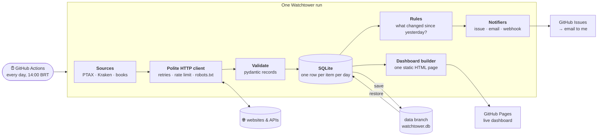

# Watchtower

[](https://github.com/odavicoelho/watchtower/actions/workflows/ci.yml)
[](https://github.com/odavicoelho/watchtower/actions/workflows/daily.yml)

**📊 Live dashboard: [odavicoelho.github.io/watchtower](https://odavicoelho.github.io/watchtower/)** · **🔔 Alerts: [issues](https://github.com/odavicoelho/watchtower/issues)**

Watchtower is a monitoring pipeline I built. Every day it goes out to a few websites and APIs, collects their data, keeps the whole history, figures out what changed since yesterday and tells me when something important happens.

The idea came from the kind of request I see all the time: "watch these competitor prices", "tell me when this is back in stock", "save this data to a database every morning". Those are all the same problem underneath, so I wanted one system that solves it properly, instead of a new script every time.

Right now it watches three public sources:

| Source | What I collect | How |
|---|---|---|
| **Banco Central do Brasil (PTAX)** | Official USD and EUR exchange rates | Open-data JSON API |
| **Kraken** | Live BTC, ETH and SOL prices | Public market-data API |
| **books.toscrape.com** | Prices and stock of a bookstore catalogue | HTML scraping with pagination (a sandbox site made for scraping) |

## The big picture



Here's how a run goes, step by step:

1. **GitHub Actions wakes it up** once a day. I didn't want a server running 24/7 just for this, and Actions is free for public repos.
2. **It restores yesterday's database** from a branch called `data`. That branch only ever has one commit, which gets replaced every day. The database file *is* the history, so I don't need git to keep old versions of it.
3. **Each source fetches its data.** A source is a small class that knows how to read one place and nothing else. Every request goes through the same HTTP client.
4. **Everything gets validated** into the same `Record` shape: item, value, unit and some extra attributes. If a site changes its layout and sends me garbage, it fails loudly here instead of quietly corrupting my history.
5. **It saves to SQLite**, then **the rules compare today with yesterday.** If something worth knowing happened, the notifiers send it out.
6. **It rebuilds the dashboard** and publishes it to GitHub Pages, then saves the database back to the `data` branch for tomorrow.

## Why I built it this way

**Sources are plugins.** The whole pipeline only knows one interface: `fetch() -> list[Record]`. To monitor a new site, I write one class and add one line to the config. Storage, rules, alerts and the dashboard don't change at all. That's the part I reuse for client work.

**I'm polite to the sites I read.** The HTTP client retries with exponential backoff (1s, 2s, 4s…), never hits the same site more than once per second, identifies itself, and respects `robots.txt`. Ignoring that last one would have been easy. In fact my first choice for crypto prices was CoinGecko, and my own client refused it because their `robots.txt` blocks bots on the API. So I switched to Kraken instead of forcing it.

**One observation per item per day.** The day is the unit of history. If I run it twice on the same day, the second run updates that day's row instead of creating a duplicate. That makes reruns completely safe, and that matters a lot when you're fixing something at night. Prices are stored as exact decimals, never floats, because money shouldn't drift.

**Rules fire on changes, not states.** "The dollar is above R$5.10" is a state. "The dollar just crossed R$5.10" is an event, and only events deserve an alert. Otherwise you get the same message every day and start ignoring it. Two more details I cared about:
- The first time a source is seen, that run is just a **baseline**. Otherwise every single item would show up as "new".
- An alert is stored once per item, per rule, per day. **The same alert is never sent twice.**

**Failures stay contained.** Each source runs on its own. If one site is down or changed its HTML, that run is marked *partial*, and every other source's data is still saved. The same goes for notifiers: if email fails, the GitHub issue still gets created.

**Secrets never touch the code or the config.** Tokens and passwords only come from environment variables. In the live demo I don't need any secret at all, because GitHub Actions already provides a token that can open issues.

**SQLite, not Postgres.** It's one file, there's no setup, and it's more than enough for this volume. For a client with bigger data, the storage layer is the only piece that would change.

**A dashboard with zero JavaScript.** It's one HTML file generated after each run, with the charts drawn as inline SVG. Nothing to host, nothing that can break in the browser, and it loads instantly.

## Run it yourself

```sh
python -m venv .venv && . .venv/bin/activate
pip install -e ".[dev]"

watchtower run                # fetch every source in config.yaml once
watchtower report --out site  # build the dashboard into site/index.html
watchtower sources            # list the available source types
```

Everything is configured in [`config.yaml`](config.yaml):

```yaml
sources:
  - type: kraken
    options: {pairs: [XBTUSD, ETHUSD]}
rules:
  - type: price_drop
    options: {source: kraken, min_percent: 5}
  - type: threshold
    options: {source: bcb_ptax, key: USD, above: 5.10}
notifiers:
  - type: email
    options: {to: you@example.com}   # needs WATCHTOWER_SMTP_USER / WATCHTOWER_SMTP_PASSWORD
```

## Adding a new source

This is all it takes:

```python
from watchtower.models import Record
from watchtower.sources.base import Source, register


@register
class MyShop(Source):
    name = "my_shop"

    def fetch(self, http):
        data = http.get("https://example.com/api/products").json()
        return [
            Record(source=self.name, key=p["sku"], name=p["title"], value=p["price"], unit="BRL")
            for p in data
        ]
```

Then add `- type: my_shop` to the config, and you get history, alerts and a spot on the dashboard for free.

## How I keep it reliable

- **48 tests, and none of them touch the internet.** I recorded real pages and API responses as fixtures, so CI never fails because some site was slow that day.
- **`ruff` and `mypy --strict`** run on every push ([CI](.github/workflows/ci.yml)).
- **The daily job** ([daily.yml](.github/workflows/daily.yml)) is public, so anyone can open the Actions tab and see that this thing actually runs every day.

## Stack

Python 3.12 · httpx · selectolax · pydantic · SQLite · Typer · Jinja2 · pytest · respx · ruff · mypy · GitHub Actions · GitHub Pages

---

Built by [Davi Coelho](https://davicoelho-comercial.vercel.app), software & data engineer. More design notes in [ARCHITECTURE.md](ARCHITECTURE.md). MIT licensed.
